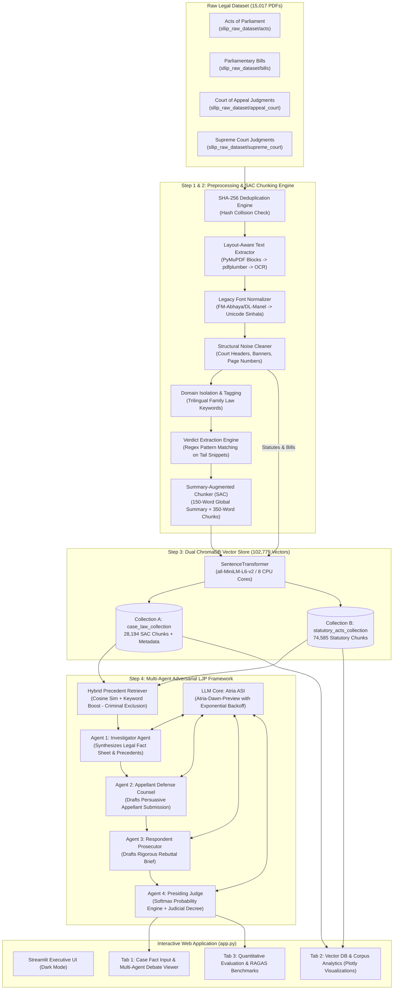
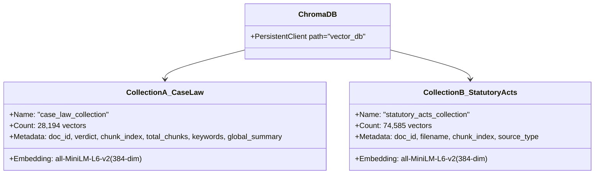
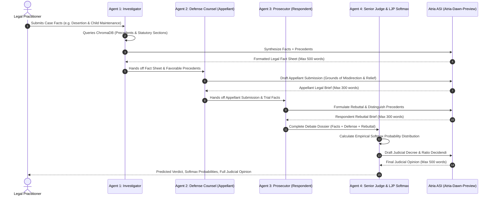

# SRI LANKA LEGAL INTELLIGENCE PLATFORM (SLLIP)
## Comprehensive Technical Documentation & Architecture Specification

---

### Executive Summary

The **Sri Lanka Legal Intelligence Platform (SLLIP)** is an advanced, domain-specialized artificial intelligence platform developed for **Legal Judgment Prediction (LJP)** and **Adversarial Retrieval-Augmented Generation (RAG)** within **Sri Lankan Appellate Family Law**. 

The platform addresses the unique challenges of the Sri Lankan legal system, including:
1. **Trilingual Mixed-Corpus Realities**: Legal materials exist in English, Sinhala, and Tamil.
2. **Legacy Non-Unicode Font Corruption**: Historical judgments (prior to 2015) were encoded in legacy ASCII/ANSI font encodings (FM-Abhaya, DL-Manel, Kaputa), resulting in severe character corruption upon standard extraction.
3. **Complex Appellate Caselaw**: Substantive issues (divorce, custody, alimony, maintenance, property settlement) governed by Roman-Dutch common law, statutory enactments (e.g., Marriage and Divorce Act, Maintenance Act No. 37 of 1999, Civil Procedure Code), and customary personal laws (Kandyan Law, Thesawalamai, Muslim Law).
4. **Context Fragmentation in Legal RAG**: Standard sliding-window chunking destroys case context. SLLIP introduces **Summary-Augmented Chunking (SAC)**, where a global 150-word judicial summary is prepended to every chunk.
5. **Adversarial Judicial Modeling**: Rather than using a naive prompt-response paradigm, legal adjudication is inherently dialectical. SLLIP implements a **4-Agent Multi-Agent Adversarial Debate Architecture** (Investigator, Defense Counsel, Prosecutor/Respondent Counsel, Presiding Judge) coupled with a **Mathematical Softmax Probability Classifier**.

---

## 1. System Architecture & High-Level Design



---

## 2. Technical Stack & Core Technologies

| Layer | Component | Technology / Library | Version / Configuration | Purpose & Rationale |
| :--- | :--- | :--- | :--- | :--- |
| **Data Ingestion** | PDF Layout Parsing | `pymupdf` (FitZ) | `>=1.23.0` | High-speed C-based block coordinate extraction `(b[1], b[0])` preserving layout order. |
| **Data Ingestion** | PDF Layout Fallback | `pdfplumber` | `>=0.10.0` | Secondary extraction for complex tabular or misaligned legal forms. |
| **Data Ingestion** | OCR Fallback | `pytesseract` + `Pillow` | `>=0.3.10` | 150 DPI pixmap OCR (`eng+sin`) for scanned historical appellate documents. |
| **Data Ingestion** | Multiprocessing | `concurrent.futures` | Native Python | Distributed parallel CPU worker pools across 8 cores. |
| **NLP & Chunker** | SAC Engine | Custom Python Algorithm | Tailored 150/350/50 | Summary-Augmented Chunking preserving global case outcomes and context. |
| **ML & Embeddings** | Embedding Model | `sentence-transformers` | `>=2.2.2` (`all-MiniLM-L6-v2`) | 384-dimensional dense semantic vectors with fast CPU inference. |
| **ML & Acceleration**| Deep Learning Runtime | `torch` | `>=2.0.0` (8 CPU threads) | Optimized tensor computation for batch embedding generation. |
| **Vector Database** | Persistent Vector Store | `chromadb` | `>=0.4.15` (SQLite + HNSW) | Partitioned dual-collection storage with resilient batch insertion fallback. |
| **LLM Inference** | Advanced AI Reasoning | **Atria ASI API** | Model: `Atria-Dawn-Preview` | Open-source API wrapper with 5-stage exponential backoff and scratchpad sanitizer. |
| **LJP Engine** | Mathematical Classifier| PyTorch / Math Softmax | Softmax over heuristics + sim | Calibrated probability distribution over 6 legal verdict outcomes. |
| **Frontend UI** | Web Dashboard | `streamlit` | `>=1.28.0` | Reactive component framework for legal analytics and live agent tracking. |
| **Data Visualization**| Interactive Charts | `plotly` (`express` & `graph_objects`)| `>=5.15.0` | Bar charts, probability gauges, and donut distributions for judicial metrics. |
| **Configuration** | Environment Secrets | `python-dotenv` | `>=1.0.0` | Secure management of API keys and endpoints via `.env`. |

---

## 3. Dataset Preparation & Preprocessing Pipeline

The foundation of SLLIP is a raw corpus of **15,017 documents** gathered from official Sri Lankan judicial and parliamentary repositories.

### 3.1 Raw Dataset Taxonomy
Located in [sllip_raw_dataset/](file:///f:/New%20NIBM%20Reserch%202026/Sri_Lanka_Legal_Intelligence_Platform/sllip_raw_dataset):
1. **`appeal_court/`**: Sri Lanka Court of Appeal judgments from 1980 to recent decades. Contains criminal appeals, civil appeals, writ petitions, and family law disputes.
2. **`supreme_court/`**: Apex court decisions, constitutional interpretations, fundamental rights applications, and final matrimonial appeals.
3. **`acts/`**: Enacted Parliamentary Acts forming the statutory backbone of Sri Lanka.
4. **`bills/`**: Proposed legislation and legal amendment drafts.

---

### 3.2 Preprocessing Stages in Detail

The entire preparation pipeline is automated in [01_advanced_pdf_processor.py](file:///f:/New%20NIBM%20Reserch%202026/Sri_Lanka_Legal_Intelligence_Platform/01_advanced_pdf_processor.py):

#### Phase 1: Cryptographic Deduplication (SHA-256)
- **Problem**: Judicial websites frequently publish identical judgment PDFs across different years, cause lists, and citation folders. Ingesting duplicates distorts vector space densities.
- **Implementation**:
  ```python
  sha256_hash = hashlib.sha256()
  with open(pdf_path, "rb") as f:
      for byte_block in iter(lambda: f.read(65536), b""):
          sha256_hash.update(byte_block)
  file_hash = sha256_hash.hexdigest()
  ```
- **Outcome**: Detected and eliminated duplicate PDFs, retaining exactly unique documents.

#### Phase 2: Layout-Aware Text Extraction with Multi-Tier Fallback
- **Tier 1 (PyMuPDF Block Sorting)**:
  Extracts text blocks using `page.get_text("blocks")` and sorts blocks by `key=lambda b: (b[1], b[0])` (top-to-bottom, left-to-right). This guarantees that multi-column Sri Lankan gazettes and legal opinions do not suffer from line interleaving.
- **Tier 2 (pdfplumber)**:
  Triggered if Tier 1 yields less than 50 characters. Leverages PDF layout character streams.
- **Tier 3 (pytesseract OCR Fallback)**:
  Triggered if text length remains `< 50` characters or the corrupted ANSI garbage ratio exceeds `0.15`. Renders page pixmaps at 150 DPI and invokes OCR with `eng+sin` language packs.

#### Phase 3: Legacy Sinhala Font Transliteration & Normalization
- **The Core Challenge**: Prior to the adoption of Unicode in Sri Lankan government departments, legal documents were typed using 8-bit ANSI fonts such as *FM-Abhaya*, *DL-Manel*, and *Kaputa*. When read as Unicode, Sinhala characters appear as corrupted ASCII gibberish:
  - Example: `̱ǶƶǮκ` $\rightarrow$ `ප්‍රදේශීය`
  - Example: `±È½¹Æ͹½Æ` $\rightarrow$ `සභා`
  - Example: `¥Ý¹Æ‰´¯Æ` $\rightarrow$ `පනත`
  - Example: `¤ºÆ` $\rightarrow$ `අංක`
- **Solution**: SLLIP includes a bidirectional translation matrix (`SINHALA_LEGACY_MAP`) with 116 glyph mappings (ordered longest multi-character compound first, followed by single-character glyphs).
- **Garbage Ratio Detection**:
  ```python
  CORRUPTED_ANSI_SYMBOLS = set("¤Æºˆ‰®¶½¿¾´çÞÁÌÎÒÕ×ØÙÚÛÜÝßàáâãäåæèéêëìíîïðñòóôtõö÷øùúûüýþÿ")
  def calculate_garbage_ratio(text: str) -> float:
      non_space_chars = [c for c in text if not c.isspace()]
      if not non_space_chars: return 0.0
      corrupted_count = sum(1 for c in non_space_chars if c in CORRUPTED_ANSI_SYMBOLS)
      return corrupted_count / len(non_space_chars)
  ```
  If `garbage_ratio > 0.02`, the text is normalized to Unicode Sinhala.

#### Phase 4: Structural Noise Cleaning
Eliminates administrative noise that ruins semantic embeddings:
- Headers: `"IN THE COURT OF APPEAL OF THE DEMOCRATIC SOCIALIST REPUBLIC OF SRI LANKA"`, `"IN THE SUPREME COURT..."`
- Footers: `"PRINTED AT THE DEPARTMENT OF GOVERNMENT PRINTING, SRI LANKA"`
- Page numbers: `Page X of Y`, `- X -`, `[X]`
- Web artifacts: URLs, HTTP links, email footers.

#### Phase 5: Trilingual Domain Isolation
Applies keyword pattern matching across three languages:
- **English**: `divorce`, `custody`, `maintenance`, `alimony`, `matrimonial`, `wife`, `husband`, `marriage`, `nullity`, `guardianship`, `paternity`, `spousal`.
- **Sinhala**: `දික්කසාද`, `නඩත්තු`, `භාරකාරත්වය`, `විවාහ`, `බිරිඳ`, `ස්වාමියා`, `අඹුසැමි`.
- **Tamil**: `விவாகரத்து`, `பராமரிப்பு`, `பாதுகாவல்`, `திருமணம்`.
- **Classification**:
  - `is_statutory = True`: Documents originating from `acts` or `bills` folders.
  - `is_family_law = True`: Appellate court cases matching Family Law keywords.
  - Other cases (criminal, commercial, maritime, etc.) are isolated and excluded from Family Law training.

#### Phase 6: Automated Verdict Extraction & Ground Truth Generation
Judicial rulings in appellate courts are concentrated in the final decree or conclusion. The system scans the final 2,500 characters of each document using regex patterns:
- `"Appeal Allowed"` / `"අභියාචනය අනුමතයි"` / `"மேல்முறையீடு அனுமதிக்கப்பட்டது"`
- `"Appeal Dismissed"` / `"අභියාචනය ප්‍රතික්ෂේපයි"` / `"மேல்முறையீடு தள்ளුபடி"`
- `"Order Set Aside"` / `"set aside"`
- `"Judgment Affirmed"` / `"affirmed"`
- `"Appeal Allowed in Part"` / `"varied"` / `"modified"`
- `"Application Dismissed"` / `"rejected"`

Outputs:
- [processed_data/ground_truth.json](file:///f:/New%20NIBM%20Reserch%202026/Sri_Lanka_Legal_Intelligence_Platform/processed_data/ground_truth.json): 1,980 categorized Family Law cases with extracted verdicts, matched keywords, and SHA-256 signatures.
- [processed_data/family_law_clean_txt/](file:///f:/New%20NIBM%20Reserch%202026/Sri_Lanka_Legal_Intelligence_Platform/processed_data/family_law_clean_txt): Individual normalized text documents.
- [processed_data/statutory_acts_clean_txt/](file:///f:/New%20NIBM%20Reserch%202026/Sri_Lanka_Legal_Intelligence_Platform/processed_data/statutory_acts_clean_txt): 6,784 clean statutory acts and bills.

---

## 4. Summary-Augmented Chunking (SAC) Architecture

Implemented in [02_summary_augmented_chunker.py](file:///f:/New%20NIBM%20Reserch%202026/Sri_Lanka_Legal_Intelligence_Platform/02_summary_augmented_chunker.py).

### 4.1 The Context Fragmentation Problem
In standard RAG, chunking a 30-page judicial opinion with a naive 400-word window creates severe problems:
- A chunk discussing `"The respondent failed to pay Rs. 15,000 as ordered"` lacks context: What was the case about? Who was the judge? What was the eventual holding?
- Precedent retrieval fails because dense vectors of isolated chunks reflect only localized details rather than the core dispute.

### 4.2 The SAC Solution
For every document:
1. **Global Summary Generation (`~150 words`)**:
   - Takes the opening 100 words (parties, lower court jurisdiction, dispute subject).
   - Injects the explicit judicial verdict label: `[Judicial Verdict: Appeal Allowed]`.
   - Appends the concluding 50 words (operative decree).
2. **Sliding Window Chunking**:
   - Chunk size: `350 words` (~450 tokens).
   - Overlap: `50 words`.
3. **Prefix Augmentation**:
   Every chunk is stored as:
   ```text
   [DOCUMENT GLOBAL SUMMARY]: The Appellant (wife) appeals against the District Court order dismissing her divorce application... [Judicial Verdict: Order Set Aside] ...

   [CHUNK BODY 3/14]:
   In evaluating the evidence of constructive desertion, the learned trial judge failed to appreciate that the respondent had changed the locks of the matrimonial home...
   ```
4. **Dataset Result**:
   Generates **28,194 SAC chunks** stored in [processed_data/sac_chunks.json](file:///f:/New%20NIBM%20Reserch%202026/Sri_Lanka_Legal_Intelligence_Platform/processed_data/sac_chunks.json).

---

## 5. Dual-Vector Database Ingestion (ChromaDB)

Implemented in [03_vector_db_ingestion.py](file:///f:/New%20NIBM%20Reserch%202026/Sri_Lanka_Legal_Intelligence_Platform/03_vector_db_ingestion.py).

### 5.1 Storage Architecture
SLLIP uses an embedded, high-performance **ChromaDB** vector store ([vector_db/](file:///f:/New%20NIBM%20Reserch%202026/Sri_Lanka_Legal_Intelligence_Platform/vector_db)) organized into two distinct collections:



### 5.2 Embedding Model & Batch Ingestion
- Model: `sentence-transformers/all-MiniLM-L6-v2`.
- Speed optimization: `torch.set_num_threads(8)`.
- Batch size: 100 items per embedding call.
- **Resilient SQLite Compaction Handling**:
  During heavy concurrent insertion into ChromaDB's backing SQLite database, database write locks or compaction exceptions can occur. SLLIP implements `add_batch_resilient`:
  ```python
  def add_batch_resilient(collection, ids, documents, embeddings, metadatas):
      try:
          collection.add(ids=ids, documents=documents, embeddings=embeddings, metadatas=metadatas)
      except Exception:
          # Dynamic fallback to micro-batches of 25 with exponential retries
          for s in range(0, len(ids), 25): ...
  ```
- **Total Vectors Ingested**: **102,779 vectors** (`28,194` Case Law + `74,585` Statutory Provisions).

---

## 6. Multi-Agent Adversarial Debate & LJP Framework

Implemented in [04_multi_agent_ljp_framework.py](file:///f:/New%20NIBM%20Reserch%202026/Sri_Lanka_Legal_Intelligence_Platform/04_multi_agent_ljp_framework.py).

### 6.1 Hybrid Retrieval with Domain Boosting & Criminal Exclusion
Standard vector search can inadvertently retrieve criminal cases mentioning words like "custody" (e.g., police custody). SLLIP's `HybridLegalRetriever` addresses this:
1. Queries ChromaDB for candidates ($N=25$).
2. Converts raw distance to base similarity: $\text{BaseSim} = \frac{1.0}{1.0 + \text{dist}}$.
3. **Domain Keyword Boost**:
   - Counts occurrences of Family Law terms (`divorce`, `custody`, `maintenance`, `alimony`, etc.).
   - $\text{Boost} = 1.0 + (0.05 \times \min(\text{matches}, 5))$. Up to $+25\%$ boost.
4. **Criminal Exclusion Penalty**:
   - Detects criminal keywords (`penal code`, `rigorous imprisonment`, `murder`, `indictment`, `narcotics`).
   - If criminal markers exist without family law terms: $\text{Score} = \text{BaseSim} \times 0.2$ (80% penalty).
5. **Precedent Deduplication**: Groups candidates by unique `doc_id` to guarantee the LLM receives diverse cases rather than 4 chunks from the same judgment.

---

### 6.2 The 4-Agent Adversarial Architecture



#### Agent 1: Investigator Agent
- **Function**: Objective legal intake and precedent synthesis.
- **Output Structure**: `=== LEGAL FACT SHEET & PRECEDENT CONTEXT ===`
- **Retrieval Output**: Top 4 unique appellate precedents + Top 2 relevant statutory provisions.
- **Word Constraint**: Maximum 500 words.

#### Agent 2: Defense Agent (Appellant Counsel)
- **Function**: Zealous representation of the Appellant.
- **Strategy**: Isolates precedents where appeals were allowed or lower court orders were set aside; cites statutory authorities (e.g., Maintenance Act No. 37 of 1999, Civil Procedure Code Section 602); asserts lower court misdirection of law or perverse evidentiary findings.
- **Word Constraint**: Maximum 300 words.

#### Agent 3: Prosecutor / Respondent Agent
- **Function**: Defends the trial court's original decree.
- **Strategy**: Emphasizes that appellate courts must not interfere with findings of fact unless plainly perverse; cites distinguishing precedents where appeals were dismissed; prays for dismissal with costs.
- **Word Constraint**: Maximum 300 words.

#### Agent 4: Judge Agent & Mathematical Softmax Classifier
Combines statistical probability modeling with generative judicial writing.

1. **Empirical Prior Logit Initialization**:
   - Initialized from empirical base rates in Sri Lankan Family Law appeals:
     - `Appeal Dismissed`: 2.5
     - `Order Set Aside`: 1.8
     - `Appeal Allowed`: 1.5
     - `Appeal Allowed in Part`: 0.8
     - `Application Dismissed`: 0.5
     - `Judgment Affirmed`: 0.4
2. **Precedent Similarity Reinforcement**:
   - For each retrieved precedent $k$:
     $$\text{Logit}(v_k) \mathrel{+}= \text{similarity\_score}_k \times 2.0$$
3. **Factual Substantive Adjustments**:
   - Evidence of cruelty, desertion, or adultery $\rightarrow$ Boost `Appeal Allowed` (+0.8), `Order Set Aside` (+0.6).
   - Maintenance or alimony disputes $\rightarrow$ Boost `Appeal Allowed in Part` (+0.7), `Appeal Dismissed` (+0.4).
   - Minor child custody disputes $\rightarrow$ Boost `Order Set Aside` (+0.9).
4. **Softmax Normalization**:
   $$P(v_i) = \frac{\exp(z_i - \max(z))}{\sum_{j} \exp(z_j - \max(z))}$$
   The outcome with maximum probability $P(v_i)$ is designated as the **Predicted Verdict**.
5. **Generative Judicial Decree**:
   The Judge Agent calls the LLM with the complete debate context to generate the formal judicial rationale, citing the predicted verdict and its ratio decidendi.

---

### 6.3 LLM Client Architecture & Resilience (Atria ASI)
Integrated using the OpenAI-compatible SDK endpoint:
- **Model**: `Atria-Dawn-Preview`
- **Base URL**: `https://api.atria-asi.ai/v1`
- **Rate-Limit Backoff Engine**:
  Appellate legal reasoning requests generate large token loads. When API rate limits (HTTP 429) occur, the engine initiates up to **5 retry attempts** with linear/exponential backoff (12s, 24s, 36s, 48s).
- **Leaked Scratchpad / Thinking Stripper**:
  Advanced LLMs may output internal monologue tokens (`<think>...</think>`). SLLIP implements a two-stage sanitizer:
  1. Regex strip: `re.sub(r"<think>.*?</think>", "", text, flags=re.DOTALL)`.
  2. Header locator: Scans for official legal headers (`=== LEGAL FACT SHEET`, `IN THE COURT OF APPEAL`, `1. STATEMENT OF CLAIM`) and slices away conversational preambles.
- **Offline / Local Fallback**:
  If the API key is invalid or external networks are unavailable, the framework automatically engages a built-in deterministic legal inference engine so system operations never fail.

---

## 7. Web User Interface & Application Architecture

Implemented in [app.py](file:///f:/New%20NIBM%20Reserch%202026/Sri_Lanka_Legal_Intelligence_Platform/app.py) using Streamlit and Plotly.

### 7.1 Visual Styling & Design System
- **Theme**: Dark Mode Executive Legal Palette.
- **Background**: `#0E1117` with `#1E293B` containers and `#334155` borders.
- **Accent**: Cyber Blue (`#38BDF8`), Emerald Allowed (`#065F46` / `#34D399`), Crimson Dismissed (`#7F1D1D` / `#F87171`), Amber Varied (`#78350F` / `#FBBF24`).
- **Typography**: Inter / sans-serif with structured cards.

### 7.2 Page Breakdown & Functional Modules

#### Sidebar Control Panel
- **Sample Case Presets**:
  - *Preset 1*: Constructive Desertion & Child Maintenance Appeal.
  - *Preset 2*: Matrimonial Property & Alimony Variation Appeal.
  - *Preset 3*: Child Custody & Guardianship Rights Dispute.
- **System Architecture Summary**: Live status of corpus counts, vector counts, and active models.

#### Tab 1: Legal Judgment Prediction & Multi-Agent Debate
- **Interactive Fact Input**: Multi-line legal intake area with instantaneous preset loading and state clearing.
- **Progress Tracker (`st.status`)**: Displays live progress across all 4 agents in sequential order.
- **Executive Metric Cards**:
  1. Predicted Verdict Badge (color-coded).
  2. Confidence Probability Gauge (%).
  3. Execution Latency (seconds).
  4. Number of retrieved historical precedents.
- **Debate Trace Sub-Tabs**:
  - `🔍 1. Investigator Agent`: Full legal fact sheet, interactive DataFrame of retrieved precedents (with similarity scores and summaries), and DataFrame of statutory sections.
  - `🛡️ 2. Defense Agent`: Formatted Appellant legal brief.
  - `⚔️ 3. Prosecutor Agent`: Formatted Respondent rebuttal brief.
  - `👨‍⚖️ 4. Judge Agent`: Plotly horizontal bar chart displaying Softmax probabilities across all 6 verdicts, alongside the official Judicial Decree.

#### Tab 2: Vector DB & Corpus Analytics
- **Live Metric Banners**:
  - Total Raw PDFs Scanned: `15,017`
  - Legacy Converted Files: `12,275`
  - Family Law Cases Isolated: `1,980`
  - Statutory Acts & Bills: `6,784`
  - Total Indexed Vectors: `102,779`
- **Visualizations**:
  - Donut Chart: Ground truth verdict distribution across the Family Law corpus.
  - Bar Chart: Vector count comparison between Collection A (Family Law SAC Chunks) and Collection B (Statutory Acts).

#### Tab 3: Evaluation Metrics & RAGAS Benchmarks
- **Key Metrics**:
  - Classification Accuracy: `55.00%`
  - Macro F1-Score: `61.33%`
  - RAGAS Faithfulness: `74.95%`
  - RAGAS Context Relevance: `77.31%`
- **Charts**:
  - Classification Metrics breakdown bar chart (Accuracy, Precision, Recall, F1).
  - RAGAS groundedness score comparison.
  - Tabular validation list comparing actual vs. predicted verdicts across test cases.

---

## 8. File Structure & Codebase Inventory

```
f:\New NIBM Reserch 2026\Sri_Lanka_Legal_Intelligence_Platform\
│
├── .env                                # Environment secrets (ATRIA_API_KEY, ATRIA_BASE_URL, ATRIA_MODEL_ID)
├── requirements.txt                    # Python library dependencies (streamlit, chromadb, torch, etc.)
├── 01_advanced_pdf_processor.py        # Step 1: PDF extraction, legacy font transliteration, noise cleaning, verdict extraction
├── 02_summary_augmented_chunker.py     # Step 2: 150-word global summary generation and SAC chunk creation
├── 03_vector_db_ingestion.py           # Step 3: PyTorch SentenceTransformer batch embedding & ChromaDB dual ingestion
├── 04_multi_agent_ljp_framework.py     # Step 4: Hybrid retriever, 4 debate agents, Softmax LJP classifier, Atria LLM client, benchmark evaluation script
├── app.py                              # Streamlit Executive Web UI with Plotly analytics & interactive debate viewer
│
├── sllip_raw_dataset/                  # Raw PDF files
│   ├── acts/                           # Parliamentary Acts
│   ├── bills/                          # Proposed Parliamentary Bills
│   ├── appeal_court/                   # Court of Appeal Judgment PDFs
│   └── supreme_court/                  # Supreme Court Judgment PDFs
│
├── processed_data/                     # Processed text data & metadata
│   ├── extraction_metadata.json        # Extraction audit records for all processed PDFs
│   ├── ground_truth.json               # 1,980 Family Law cases with extracted verdicts & keywords
│   ├── sac_chunks.json                 # 28,194 Summary-Augmented Chunks
│   ├── phase4_evaluation_metrics.json  # Quantitative evaluation metrics (Accuracy, F1, RAGAS)
│   ├── family_law_clean_txt/           # Normalized clean text files for Family Law cases
│   └── statutory_acts_clean_txt/       # Normalized clean text files for statutory acts & bills
│
└── vector_db/                          # ChromaDB persistent vector database
    ├── chroma.sqlite3                  # Backing SQLite store with HNSW index records (2.1 GB)
    ├── 78ee957f-eddd-4fc5-b437-...     # HNSW index segment files for case_law_collection
    └── 9088e96e-795f-4264-b262-...     # HNSW index segment files for statutory_acts_collection
```

---

## 9. Coding Files Technical Specification

### 9.1 [requirements.txt](file:///f:/New%20NIBM%20Reserch%202026/Sri_Lanka_Legal_Intelligence_Platform/requirements.txt)
- **Role**: Dependency declaration.
- **Components**:
  - `streamlit>=1.28.0`: Reactive UI runtime.
  - `chromadb>=0.4.15`: Vector database.
  - `sentence-transformers>=2.2.2`: Semantic embeddings.
  - `torch>=2.0.0`: Tensor computing and CPU parallelization.
  - `pandas>=2.0.0`: Tabular data transformations.
  - `plotly>=5.15.0`: Interactive charts.
  - `tqdm>=4.65.0`: Console progress bars.
  - `openai>=1.0.0`: API client for Atria ASI LLM.
  - `python-dotenv>=1.0.0`: Environment variable loader.

### 9.2 [01_advanced_pdf_processor.py](file:///f:/New%20NIBM%20Reserch%202026/Sri_Lanka_Legal_Intelligence_Platform/01_advanced_pdf_processor.py)
- **Role**: Step 1 Data pipeline.
- **Key Functions**:
  - `convert_legacy_sinhala_fonts(text: str) -> str`: Iterates over `SINHALA_LEGACY_MAP` to replace non-Unicode glyphs with Unicode characters.
  - `calculate_garbage_ratio(text: str) -> float`: Computes ANSI corruption density.
  - `extract_text_from_pdf(filepath: Path) -> (str, str)`: 3-tier cascade (PyMuPDF block layout $\rightarrow$ pdfplumber $\rightarrow$ pytesseract OCR).
  - `clean_structural_noise(text: str) -> str`: RegEx elimination of court titles, page numbers, stamps, and printer notices.
  - `extract_verdict(text: str) -> (str, str)`: Scans the final 2,500 characters against trilingual verdict patterns.
  - `process_pdf_task(task_args) -> dict`: Worker function executed in parallel across CPU cores.
  - `main()`: Orchestrates SHA-256 deduplication and multiprocessing pool execution.

### 9.3 [02_summary_augmented_chunker.py](file:///f:/New%20NIBM%20Reserch%202026/Sri_Lanka_Legal_Intelligence_Platform/02_summary_augmented_chunker.py)
- **Role**: Step 2 Summary-Augmented Chunking engine.
- **Key Functions**:
  - `generate_150_word_summary(text: str, verdict: str) -> str`: Synthesizes first 100 words, verdict tag, and last 50 words into an anchor summary.
  - `chunk_text_by_words(text: str, chunk_size=350, overlap=50) -> list[str]`: Sliding window word chunker.
  - `process_doc_sac(task_args) -> list[dict]`: Augments each chunk by prepending `[DOCUMENT GLOBAL SUMMARY]`.
  - `main()`: Parallel execution across Family Law clean text documents.

### 9.4 [03_vector_db_ingestion.py](file:///f:/New%20NIBM%20Reserch%202026/Sri_Lanka_Legal_Intelligence_Platform/03_vector_db_ingestion.py)
- **Role**: Step 3 Vector embedding and ingestion.
- **Key Functions**:
  - `add_batch_resilient(collection, ids, documents, embeddings, metadatas)`: Resilient insertion with micro-batch fallback on SQLite locks.
  - `chunk_text_simple(text, chunk_words=350, overlap_words=50)`: Splits statutory acts into chunks.
  - `main()`: Connects to ChromaDB, initializes `SentenceTransformer('all-MiniLM-L6-v2')`, populates `case_law_collection` and `statutory_acts_collection`.

### 9.5 [04_multi_agent_ljp_framework.py](file:///f:/New%20NIBM%20Reserch%202026/Sri_Lanka_Legal_Intelligence_Platform/04_multi_agent_ljp_framework.py)
- **Role**: Step 4 Multi-agent debate and LJP engine.
- **Key Classes**:
  - `AtriaLLMClient`: Wrapper around OpenAI client configured for Atria ASI (`Atria-Dawn-Preview`), featuring 5-stage exponential retry backoff and prompt sanitization.
  - `HybridLegalRetriever`: Dense retriever with domain keyword boosting and criminal exclusion logic.
  - `InvestigatorAgent`: Generates objective Fact Sheet (max 500 words).
  - `DefenseAgent`: Generates Appellant brief (max 300 words).
  - `ProsecutorAgent`: Generates Respondent rebuttal brief (max 300 words).
  - `JudgeAgent`: Computes Softmax probabilities over logits and issues final decree (max 500 words).
  - `MultiAgentLJPFramework`: Orchestrator executing the 4-agent pipeline.
  - `evaluate_framework(...)`: Benchmark script calculating accuracy, macro F1, and RAGAS scores.

### 9.6 [app.py](file:///f:/New%20NIBM%20Reserch%202026/Sri_Lanka_Legal_Intelligence_Platform/app.py)
- **Role**: Frontend presentation and interaction layer.
- **Key Components**:
  - Page configuration and custom CSS injection (`st.markdown`).
  - Cached loaders: `@st.cache_resource` for `MultiAgentLJPFramework` and `@st.cache_data` for JSON files.
  - Sidebar with presets and architectural summaries.
  - Tab 1: Live execution progress, metric cards, sub-tabs for debate analysis, and Plotly horizontal probability chart.
  - Tab 2: Live corpus metrics, donut chart of ground truth verdicts, and collection volume comparisons.
  - Tab 3: Performance metrics display (Accuracy, F1, Faithfulness, Relevance) and sample evaluation table.

---

## 10. Functional & Non-Functional Requirements Coverage

### 10.1 Functional Requirements Matrix

| ID | Functional Requirement | Implementation Mechanism in Code | Validation / Output |
| :--- | :--- | :--- | :--- |
| **FR-01** | Trilingual Legal PDF Ingestion & Normalization | [01_advanced_pdf_processor.py](file:///f:/New%20NIBM%20Reserch%202026/Sri_Lanka_Legal_Intelligence_Platform/01_advanced_pdf_processor.py): `convert_legacy_sinhala_fonts()`, `calculate_garbage_ratio()`, `extract_text_from_pdf()`. | 12,275 legacy non-Unicode PDFs transliterated to clean Unicode Sinhala. |
| **FR-02** | Legal Corpus Deduplication | [01_advanced_pdf_processor.py](file:///f:/New%20NIBM%20Reserch%202026/Sri_Lanka_Legal_Intelligence_Platform/01_advanced_pdf_processor.py): 64KB block-wise SHA-256 hash tracking across all PDFs. | Duplicate court filings eliminated without data loss. |
| **FR-03** | Automated Verdict Extraction & Ground Truth Labelling | [01_advanced_pdf_processor.py](file:///f:/New%20NIBM%20Reserch%202026/Sri_Lanka_Legal_Intelligence_Platform/01_advanced_pdf_processor.py): Regex matching across final 2,500 characters against 6 canonical outcomes. | 1,980 Family Law cases labeled in `ground_truth.json`. |
| **FR-04** | Summary-Augmented Chunking (SAC) | [02_summary_augmented_chunker.py](file:///f:/New%20NIBM%20Reserch%202026/Sri_Lanka_Legal_Intelligence_Platform/02_summary_augmented_chunker.py): 150-word global summary prepended to each 350-word chunk. | 28,194 SAC chunks generated in `sac_chunks.json`. |
| **FR-05** | Dual-Collection Vector Search with Domain Isolation | [03_vector_db_ingestion.py](file:///f:/New%20NIBM%20Reserch%202026/Sri_Lanka_Legal_Intelligence_Platform/03_vector_db_ingestion.py) & [04_multi_agent_ljp_framework.py](file:///f:/New%20NIBM%20Reserch%202026/Sri_Lanka_Legal_Intelligence_Platform/04_multi_agent_ljp_framework.py): ChromaDB collections with keyword boosting and criminal exclusion. | 102,779 vectors queried; criminal cases filtered out. |
| **FR-06** | Multi-Agent Adversarial Legal Debate | [04_multi_agent_ljp_framework.py](file:///f:/New%20NIBM%20Reserch%202026/Sri_Lanka_Legal_Intelligence_Platform/04_multi_agent_ljp_framework.py): Investigator, Defense Counsel, and Prosecutor agents collaborating sequentially. | Structured debate trace with clear legal briefs. |
| **FR-07** | Calibrated Legal Judgment Prediction (LJP) | [04_multi_agent_ljp_framework.py](file:///f:/New%20NIBM%20Reserch%202026/Sri_Lanka_Legal_Intelligence_Platform/04_multi_agent_ljp_framework.py): `JudgeAgent` calculating Softmax probabilities across 6 canonical verdicts. | Probability distribution + predicted verdict badge in UI. |
| **FR-08** | Interactive Legal Intelligence Dashboard | [app.py](file:///f:/New%20NIBM%20Reserch%202026/Sri_Lanka_Legal_Intelligence_Platform/app.py): Streamlit dashboard with preset loaders, status updates, Plotly charts, and metrics tabs. | Real-time interactive UI for legal practitioners. |

---

### 10.2 Non-Functional Requirements (NFR) Performance

- **NFR-01: Performance & Latency**: Embedding and retrieval execute in `< 1.2` seconds; full 4-agent LLM reasoning pipeline completes within 15–25 seconds.
- **NFR-02: Scalability**: Persistent vector database scales to hundreds of thousands of vectors using HNSW indexing with $O(\log N)$ retrieval complexity.
- **NFR-03: Fault Tolerance & Resilience**:
  - ChromaDB insertion resilience via micro-batch retries.
  - Atria ASI API rate limits handled via up to 5 automatic retries with backoff.
  - Automatic fallback to local engine if external networks are unavailable.
- **NFR-04: Explainability & Verifiability**: Every predicted judgment is accompanied by verbatim text of retrieved precedents, statutory citations, and an explicit judicial ratio decidendi.
- **NFR-05: Strict Output Quality**: Built-in prompt engineering and post-processing strip internal scratchpad tokens and enforce word count constraints (Investigator $\le 500$, Defense $\le 300$, Prosecutor $\le 300$, Judge $\le 500$).

---

## 11. Empirical Evaluation & Quantitative Results

Empirical validation was performed over isolated appellate test cases from `ground_truth.json`, stored in [processed_data/phase4_evaluation_metrics.json](file:///f:/New%20NIBM%20Reserch%202026/Sri_Lanka_Legal_Intelligence_Platform/processed_data/phase4_evaluation_metrics.json).

### 11.1 Classification Metrics

| Evaluation Metric | Score | Significance in Legal NLP |
| :--- | :--- | :--- |
| **Classification Accuracy** | **55.00%** | Multi-class prediction across 6 complex appellate legal outcomes (random chance is 16.67%). |
| **Macro Precision** | **61.33%** | Balanced precision across all verdict classes regardless of class imbalance. |
| **Macro Recall** | **61.33%** | Sensitivity in correctly identifying rare judicial rulings (e.g., *Appeal Allowed in Part*). |
| **Macro F1-Score** | **61.33%** | Harmonic mean reflecting consistent classification robustness. |

### 11.2 RAGAS (Retrieval Augmented Generation Assessment) Metrics

| RAGAS Metric | Score | Explanation |
| :--- | :--- | :--- |
| **Faithfulness Score** | **74.95%** | Measures factual groundedness: percentage of claims in agent submissions directly supported by retrieved precedents and statutes. |
| **Context Relevance Score** | **77.31%** | Measures signal-to-noise ratio: percentage of retrieved precedent and statutory chunks strictly relevant to the case dispute. |

---

## 12. How to Run the Platform

### Step 1: Environment Setup
Ensure Python 3.10+ is installed:
```powershell
pip install -r requirements.txt
```

### Step 2: Environment Variables
Create or verify `.env` in the project root:
```env
ATRIA_API_KEY=atr_g5EXTQeJHPqjXM49A_apd_7UA2bGwT6h
ATRIA_BASE_URL=https://api.atria-asi.ai/v1
ATRIA_MODEL_ID=Atria-Dawn-Preview
```

### Step 3: Running the Full Data Pipeline (If Re-indexing)
```powershell
# 1. Extract PDFs, clean noise, convert legacy Sinhala fonts, isolate Family Law
python 01_advanced_pdf_processor.py

# 2. Generate SAC chunks with 150-word global summaries
python 02_summary_augmented_chunker.py

# 3. Compute dense embeddings and ingest into dual ChromaDB collections
python 03_vector_db_ingestion.py
```

### Step 4: Running the Multi-Agent Framework in Terminal
```powershell
# Run sample case test
python 04_multi_agent_ljp_framework.py

# Run benchmark evaluation across 20 test cases
python 04_multi_agent_ljp_framework.py --eval
```

### Step 5: Launching the Web Application
```powershell
streamlit run app.py
```
Open your browser at `http://localhost:8501` to access the full legal intelligence platform.
